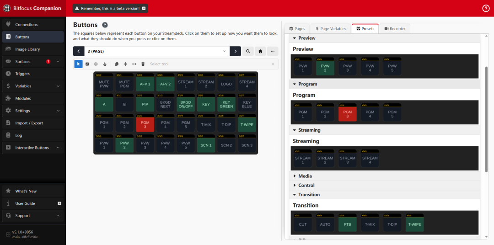

# companion-module-feelworld-l3-series

## Project Overview

This is a [Bitfocus Companion](https://bitfocus.io/companion) module for controlling the **Feelworld L3** video switcher over UDP.

Bitfocus Companion is a software platform that lets you control broadcast/production equipment through stream decks and button panels. Each device is controlled via a dedicated "module" plugin. This project implements the module for the Feelworld L3 video switcher.

**Key Features:**

- UDP communication with the Feelworld L3 / L3 Pro
- Preview (PVW) / Program (PGM) source switching (up to 5 inputs)
- Cut / Auto / FTB transitions and transition type selection (MIX / DIP / WIPE)
- Streaming toggles for STREAM 1–4 (auto-confirmation on start; button warning when the stream address is empty)
- Recording start/stop (USB disk check before start; NO DISK button warning)
- Media playback control (play/pause/stop/previous/next)
- Scene presets 1–8; tapping the active scene again exits it
- PIP (Picture-in-Picture): toggle, templates, aspect, position and size adjustment
- PTZ camera control (pan/tilt/stop/reset/focus)
- Chroma key (on/off, green/blue with mutually exclusive highlighting)
- Logo / background overlay toggles
- Effect mode selection (Modes 1–16)
- Audio control: monitor (PVW)/PGM mute, volume stepping, AFV 1–5
- Automatic device state sync on connection (PGM/PVW, streaming, recording, scenes, audio, etc.)
- Rich button state feedbacks and instant-action flash highlighting
- Companion variables for current PGM/PVW source numbers



---

## Project Structure

```
companion-module-feelworld-l3-series/
├── src/
│   ├── main.ts          # Main entry: init, UDP socket, send/receive logic
│   ├── actions.ts       # All Action definitions and command mappings
│   ├── feedbacks.ts     # All Feedback definitions
│   ├── presets.ts       # Preset button definitions (auto-generated from actions)
│   ├── variables.ts     # Companion variable definitions
│   └── upgrades.ts      # Upgrade scripts (version migration; currently empty)
├── companion/
│   ├── manifest.json    # Module metadata (ID, name, version, config fields)
│   └── HELP.md          # Help text shown inside Companion UI
├── docs/
│   └── presets.png      # Preset panel screenshot (shown in README)
│   (protocol_new.md / protocol.md are internal protocol documents, not included in this public repository)
├── package.json         # Node.js project configuration
├── tsconfig.json        # TypeScript compiler configuration
└── README.md            # This file
```

---

## Installation & Build

### Prerequisites

- Node.js 26 (matching the module manifest runtime requirement)
- yarn (recommended) or npm
- Bitfocus Companion (v3.0+, latest stable recommended)

### Install Dependencies

```bash
yarn install
```

### Build

```bash
yarn build
```

Compiled output goes to `dist/`. Companion loads `dist/main.js`.

### Development Mode (watch & auto-recompile)

```bash
yarn dev
```

TypeScript recompiles on every file save. Companion automatically reloads the module — no manual restart needed.

### Loading in Companion for Development

1. In Companion Launcher settings, set **"Developer modules path"** to the **parent folder** of this module directory.
2. In Companion, go to Connections and add a "Feelworld L3" connection.
3. View `debug`/`info`/`error` logs in the Companion Log panel.

---

## Device Configuration

Configure the following in Companion's Connection settings:

| Field             | Description                    | Default         |
| ----------------- | ------------------------------ | --------------- |
| Device IP Address | IP address of the Feelworld L3 | `192.168.1.100` |
| Port              | UDP communication port         | `39187`         |

> **Note:** The Companion host and L3 must be on the same LAN. Ensure your firewall allows UDP on the configured port.

---

## Communication Protocol

The module uses a custom UDP binary protocol — the **new version** organized by CMD functional domains. The protocol documents (`protocol_new.md` / `protocol.md`) are vendor-internal materials and are not distributed with this public repository; see the protocol summary below.

> **Note:** In the new protocol, CMDs are grouped by functional domain (e.g., 0x10 input, 0x12 media, 0x20 PIP, 0x31 effects, 0x53 keys, 0x61 recording, 0x70 PTZ). Example frames in the protocol document may not match their definitions due to historical leftovers — **always follow the frame definition tables**.

### Send Frame Format

```
(R<ADDR><SN><CMD><DAT1><DAT2><DAT3><DAT4><CHKSUM>)
```

All fields are 2-char hex ASCII. Total length: 19 characters.  
`CHKSUM = (ADDR + SN + CMD + DAT1 + DAT2 + DAT3 + DAT4) & 0xFF`

### Receive Frame Format

```
(S<ADDR><SN><CMD><DAT1><DAT2><DAT3><DAT4><CHKSUM>)
```

### JSON Extended Commands (CMD = 0xB0 / 0xB1)

Used for structured payloads (e.g., recording control, chroma key params).  
Format: standard header + UTF-8 JSON string + data checksum byte.

### Command Send Methods

| Method                                                     | Purpose                                                        |
| ---------------------------------------------------------- | -------------------------------------------------------------- |
| `sendCommand(cmd, dat1, dat2, dat3, dat4)`                 | Send a standard binary frame                                   |
| `sendKeyPress(keyCode)`                                    | Simulate key press (CMD=0x53, press + release with 50ms delay) |
| `sendAiVoiceKeyPress(functionCode)`                        | Send an AI voice module key (CMD=0x8A)                         |
| `sendJsonCommand(cmd, dat1, dat2, payload)`                | Send a JSON extended command (CMD=0xB0)                        |
| `toggleStream(index)`                                      | Toggle streaming STREAM 1–4 (JSON command 0xB0 0x60 0x04)      |
| `toggleRecord()`                                           | Recording toggle (with USB disk check)                         |
| `toggleScene(scene)`                                       | Scene recall / exit toggle                                     |
| `toggleKey()` / `toggleLogo()` / `toggleBackgroundPower()` | Key / logo / background toggles                                |

### Command Mapping of Implemented Features (New Protocol)

| Feature                                                                               | Command                                                                                                                                      |
| ------------------------------------------------------------------------------------- | -------------------------------------------------------------------------------------------------------------------------------------------- |
| Key-based actions (source switching / Cut / Auto / FTB / PIP / transition type, etc.) | `0x53 0x01` + key code (DAT3: 0x01 press / 0x02 release)                                                                                     |
| Media play / pause / stop                                                             | `0x12 0x00`, DAT2: 0x01 play / 0x02 pause / 0x00 stop                                                                                        |
| Previous / next media                                                                 | `0x12 0x04` / `0x12 0x02`                                                                                                                    |
| Streaming STREAM 1–4 toggles                                                          | JSON `0xB0 0x60 0x04` `{"index":0-3,"ispush":bool}` (confirmed by a following `0xB1 0x58` streamInfo push; silent when the address is empty) |
| Record start / stop                                                                   | JSON `0xB0 0x61 0x01` `{"isStart":bool}`                                                                                                     |
| USB disk presence check (before recording)                                            | `0x61 0x09` (reply DAT2: 0x01 present / 0x00 absent)                                                                                         |
| PIP toggle / layers / templates / aspect / position                                   | `0x20 0x04/0x08/0x06/0x0A/0x00-0x03` etc.                                                                                                    |
| Effect modes 1–16                                                                     | `0x31 0x00`, DAT2=0x00–0x0F                                                                                                                  |
| Scene recall / exit / read                                                            | `0x30 0x00` (DAT2=1-8) / `0x30 0x04` / `0x30 0x01`                                                                                           |
| Mute / volume                                                                         | `0x41 0x00/0x01/0x02/0x03` (DAT2: 0x00 monitor PVW / 0x01 PGM)                                                                               |
| AFV 1–5                                                                               | `0x40 0x01/0x02` (DAT3=channel 0-4)                                                                                                          |
| Logo on / off / query                                                                 | `0x23 0x02` (DAT2 fixed 0x00, DAT3=On/Off) / `0x23 0x03`                                                                                     |
| Background on / off / select / query                                                  | `0x22 0x00` / `0x22 0x02` / `0x22 0x03`                                                                                                      |
| Chroma key on-off / mode / params / query                                             | `0x24 0x00` / `0x24 0x02 0x01` / JSON `0xB0 0x24 0x04` / `0xB1 0x24 0x05`                                                                    |
| PTZ reset / focus / direction                                                         | `0x70 0x09` / `0x70 0x06` / `0x70 0x0B`                                                                                                      |
| FTB / status read                                                                     | key press / `0x31 0x09` (reply DAT1=0x09, DAT2: 0x00 on / 0x01 off)                                                                          |
| PGM/PVW source read (reply)                                                           | `0x20 0x0d` (PGM) / `0x20 0x0e` (PVW), reply DAT2 = source index 0–4                                                                         |
| Device state push (JSON)                                                              | `0xB1 0x58` (streamInfo / recordInfo / keyInfo / sceneInfo / effectInfo / audioInfo, etc.)                                                   |
| AI voice keys (PIP adjust steps, etc.)                                                | `0x8A 0x01` + function code                                                                                                                  |

### Known Device Issues & Module Compatibility Workarounds (verified on L3 Pro firmware)

1. **Non-strict report JSON**: keys may be unquoted (e.g. `data:`, `dev_name:`) with a trailing checksum byte. The module uses a tolerant parser (`tryParseLooseJson`).
2. **streamInfo push header anomaly**: the DAT3/DAT4 length field deviates from the spec. The module extracts 0xB0/0xB1 JSON payloads by brace matching instead of trusting the length field.
3. **One-beat-late acknowledgements**: after writing chroma params or a stream toggle, the immediately pushed `keyInfo.chromaInfo` / `streamInfo.urlInfo` still carry the pre-write values. Therefore: chroma green/blue highlighting combines reported color/range with the locally last-sent choice; stream start confirmation is based on receiving a streamInfo push, not on its `isPush` value.
4. **streamInfo.urlInfo `id` starts from 1** (id=1 → STREAM1), unlike zero-based array conventions; parsed as `id-1`.
5. **Unimplemented read commands may silence the device**: sending `0xB1 0x60 0x02` (25.3 read stream list), which this firmware does not implement, can make the device stop responding entirely (suspected firmware bug; requires a power cycle). The module avoids this command — when developing new features, suspect unimplemented commands if the device goes fully silent.

---

## Feature List

### Actions

| Category            | Action IDs                                                                                             | Description                                                |
| ------------------- | ------------------------------------------------------------------------------------------------------ | ---------------------------------------------------------- |
| **Preview**         | `pvw_source_1` – `pvw_source_5`                                                                        | Set PVW to Input 1–5                                       |
| **Program**         | `pgm_source_1` – `pgm_source_5`                                                                        | Set PGM to Input 1–5                                       |
| **Transition**      | `cut` / `auto` / `ftb`                                                                                 | Cut, Auto, Fade to Black                                   |
| **Transition Type** | `transition_mix` / `transition_dip` / `transition_wipe`                                                | Set transition type (state feedback)                       |
| **Streaming**       | `stream_toggle_1` – `stream_toggle_4`                                                                  | Toggle STREAM 1–4 (warning when address empty)             |
| **Media**           | `media_play` / `media_pause` / `media_stop` / `media_previous` / `media_next`                          | Media playback                                             |
| **Recording**       | `record_toggle`                                                                                        | Recording toggle (NO DISK warning without USB disk)        |
| **Scenes**          | `scene_recall_1` – `scene_recall_8`                                                                    | Recall scene preset; tap again to exit                     |
| **PIP**             | `pip_toggle` / `pip_template_1–8` / `pip_aspect_*` / `pip_x/y/size_*`                                  | PIP control                                                |
| **Layers**          | `layer_a` / `layer_b`                                                                                  | Layer A/B selection                                        |
| **PTZ**             | `ptz_up/down/left/right/stop/reset` / `ptz_focus_auto/manual`                                          | PTZ camera                                                 |
| **Logo**            | `logo_toggle`                                                                                          | Logo overlay toggle                                        |
| **Background**      | `background_toggle` / `background_power_toggle`                                                        | Cycle background image / background layer toggle           |
| **Chroma Key**      | `key_toggle` / `key_green` / `key_blue`                                                                | Keyer toggle / green / blue (mutually exclusive highlight) |
| **Effect Modes**    | `effect_mode_1` – `effect_mode_16`                                                                     | Effect template selection                                  |
| **Audio**           | `pvw_mute_toggle` / `pgm_mute_toggle` / `pvw_volume_up/down` / `pgm_volume_up/down` / `afv_toggle_1~5` | Mute / volume stepping / AFV                               |
| **Misc**            | `zoom_tele` / `zoom_wide` / `menu` / `back`                                                            | Zoom/menu/back                                             |

### Feedbacks

| Feedback ID                                                                  | Description                                                           | Default Style          |
| ---------------------------------------------------------------------------- | --------------------------------------------------------------------- | ---------------------- |
| `pgm_source` / `pvw_source`                                                  | Highlight when a specific source is on PGM / PVW (selectable)         | Red / green background |
| `pgm_pvw_same`                                                               | Highlight when PGM and PVW source match (warning)                     | Yellow background      |
| `record_active`                                                              | Highlight while recording                                             | Green background       |
| `record_no_disk`                                                             | Brief warning when a record start was blocked (no USB disk)           | Yellow NO DISK         |
| `stream_1_active` – `stream_4_active`                                        | Highlight while the corresponding stream is pushing                   | Green background       |
| `stream_no_addr`                                                             | Brief warning when a stream start got no confirmation (address empty) | Yellow ADDRESS EMPTY   |
| `scene_active`                                                               | Highlight when the selected scene preset is active                    | Green background       |
| `pip_active` / `key_active` / `logo_active` / `background_active`            | Highlight when PIP / keyer / logo / background layer is on            | Green background       |
| `key_green_active` / `key_blue_active`                                       | Highlight when chroma key uses green / blue (mutually exclusive)      | Green background       |
| `pvw_mute_active` / `pgm_mute_active`                                        | Highlight when the corresponding output is muted                      | Green background       |
| `afv_1_active` – `afv_5_active`                                              | Highlight when the corresponding AFV is enabled                       | Green background       |
| `layer_a_active` / `layer_b_active`                                          | Highlight when layer A / B is selected                                | Green background       |
| `ftb_active`                                                                 | Highlight when fade to black is active                                | Green background       |
| `transition_mix_active` / `transition_dip_active` / `transition_wipe_active` | Highlight when the transition type is selected                        | Green background       |
| `flash_active`                                                               | Flash highlight when an instant action runs (selectable)              | Green background       |

> Presets carry their feedbacks automatically; buttons dragged before a feedback change must be re-dragged to pick up new feedbacks.

### Variables

| Variable ID   | Description                     |
| ------------- | ------------------------------- |
| `current_pgm` | Current PGM source number (1–5) |
| `current_pvw` | Current PVW source number (1–5) |

---

## Secondary Development Notes

### 1. Understand the Architecture First

- **`main.ts`** is the core — UDP socket lifecycle, frame construction, response parsing, state management. Be careful modifying `handleResponse()`; it depends on the exact device frame format.
- **`actions.ts`** uses a data-driven `ACTION_SPECS` array that drives both action registration and preset generation. Keep this pattern.
- **`presets.ts`** auto-generates all presets from `ACTION_SPECS` — no manual preset work needed when adding new actions.

### 2. Protocol Byte Order & Checksum

- All frame fields must be 2-char hex ASCII: `value.toString(16).padStart(2, '0')`.
- An incorrect CHKSUM causes the device to **silently ignore** the command — no error response is returned.
- JSON extended frames (0xB0/0xB1) carry a data block whose last byte is a constant trailer character (`a`) on current firmware — not a per-frame checksum.

### 3. UDP Is Connectionless

- The connection status turns OK only after the **first reply from the device** arrives; until then it shows "Connecting", and "Connection failure" if the device does not answer the startup queries.
- Commands sent to an offline device fail silently (only logged).
- For device discovery, see the UDP broadcast flow in the vendor protocol document (internal material, not included in this repository).

### 4. State Feedback & Variable Updates

- On connection, `syncAllStates()` sends a round of read commands to sync all feature states; during operation the module parses device pushes:
  - Fixed-frame replies are parsed in `handleFixedFrame()` (PGM/PVW 0x20 0x0d/0x0e, background 0x22 0x03, keyer 0x24 0x03, scene 0x30 0x01, effects 0x31 0x01, FTB 0x31 0x09, USB disk 0x61 0x09, etc.).
  - JSON state pushes (0xB1 0x58) are parsed in `applyJsonReport()` (streamInfo / recordInfo / keyInfo / sceneInfo / effectInfo / audioInfo, etc.).
- The module does not poll at runtime; some write operations use a send-then-wait-for-confirmation pattern (streaming, USB disk check, background query).
- To track more device states, add a branch in the corresponding parser, update instance state, then call `this.checkFeedbacks()` (and `this.setVariableValues()` when needed).
- Mind the verified firmware quirks (non-strict JSON, late acknowledgements, 1-based urlInfo ids) — see "Known Device Issues & Module Compatibility Workarounds".

### 5. TypeScript Type Safety

- Current actions use `NO_OPTIONS` (no user-configurable parameters). To add parameters, update both the `options` array and the `callback` to read from `action.options`.
- See `feedbacks.ts` (`SOURCE_OPTIONS`) for a dropdown parameter example.

### 6. Version Synchronization

- On every release, `companion/manifest.json` → `version` and `package.json` → `version` must match.
- The `id` field in `manifest.json` is the permanent module identifier. **Never change it** after publishing — it will break all existing user configurations.

### 7. Debugging Tips

- Use `this.log('debug', ...)` to log sent/received data — visible in Companion's Log panel in real time.
- Use Wireshark to capture UDP packets and validate against the vendor protocol document.
- In dev mode (`yarn dev`), file saves trigger auto-recompile and Companion auto-reloads the module.

---

## Quick Guide: Adding New Features

### Case 1: Add a Simple Action (single command, no user input)

**Example:** "Set transition duration to 3 seconds" — CMD=0x31, DAT1=0x04, DAT2=0x03 (new protocol 13.5, transition duration).

**Step 1** — Open `src/actions.ts`, add to `ACTION_SPECS` (before the closing `]`):

```typescript
commandAction('transition_duration_3s', 'Transition Duration 3s', 'Set transition duration to 3 seconds', 0x31, 0x04, 0x03),
```

**Step 2 (optional)** — Add a preset category in `src/presets.ts` → `CATEGORY_BY_ACTION`:

```typescript
transition_duration_3s: 'Transition',
```

**Step 3** — Rebuild:

```bash
yarn build
```

Done. Companion exposes the new action automatically.

---

### Case 2: Add an Action with User Parameters

**Example:** A single "Set PVW Source" action where the user picks the input.

In `src/actions.ts`, inside `UpdateActions()`, add:

```typescript
actions['pvw_source_dynamic'] = {
	name: 'Set PVW Source',
	description: 'Set Preview to a user-selected input',
	options: [
		{
			type: 'dropdown',
			id: 'source',
			label: 'Source',
			default: '1',
			choices: [
				{ id: '1', label: 'Input 1' },
				{ id: '2', label: 'Input 2' },
				{ id: '3', label: 'Input 3' },
				{ id: '4', label: 'Input 4' },
				{ id: '5', label: 'Input 5 (Media)' },
			],
		},
	],
	callback: async (action) => {
		const sourceNum = parseInt(action.options.source as string)
		const keyMap: Record<number, number> = {
			1: KEY_CODES.KEY_PVW_SOURCE_1,
			2: KEY_CODES.KEY_PVW_SOURCE_2,
			3: KEY_CODES.KEY_PVW_SOURCE_3,
			4: KEY_CODES.KEY_PVW_SOURCE_4,
			5: KEY_CODES.KEY_PVW_SOURCE_5,
		}
		const key = keyMap[sourceNum]
		if (key !== undefined) await instance.sendKeyPress(key)
	},
}
```

---

### Case 3: Add a New Feedback

**Example:** "Recording Active" feedback.

**Step 1** — Track state in `src/main.ts`:

```typescript
private isRecording: boolean = false

isRecordingActive(): boolean { return this.isRecording }

// In handleFixedFrame(), add the relevant CMD branch:
// if (cmd === 0xXX) {
//     this.isRecording = dat1 === 0x01
//     this.checkAllFeedbacks()
// }
```

**Step 2** — Define in `src/feedbacks.ts`:

```typescript
feedbacks['recording_active'] = {
	type: 'boolean',
	name: 'Recording Active',
	description: 'Highlight when recording is active',
	defaultStyle: { bgcolor: 0xff0000, color: 0xffffff },
	options: [],
	callback: () => instance.isRecordingActive(),
}
```

---

### Case 4: Add a New Variable

**Step 1** — Declare in `src/variables.ts`:

```typescript
recording_state: { name: 'Recording State' },
```

**Step 2** — Set value in `src/main.ts` → `updateVariableValues()`:

```typescript
this.setVariableValues({
	current_pgm: this.currentPgm,
	current_pvw: this.currentPvw,
	recording_state: this.isRecording ? 'Recording' : 'Stopped',
})
```

---

### Case 5: Add a JSON Extended Command Action

Fixed payload (example: set PIP scale parameters, new protocol 6.1, CMD=0xB0 DAT1=0x20 DAT2=0x00):

```typescript
jsonAction('pip_set_scale', 'PIP Scale', 'Set PIP scale parameters', 0xb0, 0x20, 0x00, {
    layer: 1,
    posX: 200,
    posY: 51,
    sizeX: 200,
    sizeY: 160,
}),
```

Dynamic payload (user-defined values), in `UpdateActions()`:

```typescript
actions['pip_set_scale_dynamic'] = {
	name: 'PIP Set Scale',
	description: 'Set PIP scale to custom values',
	options: [
		{ type: 'number', id: 'posX', label: 'Pos X', default: 0, min: 0, max: 3840 },
		{ type: 'number', id: 'posY', label: 'Pos Y', default: 0, min: 0, max: 2160 },
	],
	callback: async (action) => {
		const posX = action.options.posX as number
		const posY = action.options.posY as number
		await instance.sendJsonCommand(0xb0, 0x20, 0x00, {
			layer: 1,
			posX,
			posY,
			sizeX: 200,
			sizeY: 160,
		})
	},
}
```

---

## Resources

- [Bitfocus Companion](https://bitfocus.io/companion)
- [Module Development Guide](https://companion.free/for-developers/module-development/)
- [companion-module-base API Docs](https://bitfocus.github.io/companion-module-base/)
- [TypeScript Module Template](https://github.com/bitfocus/companion-module-template-ts)

## License

MIT
